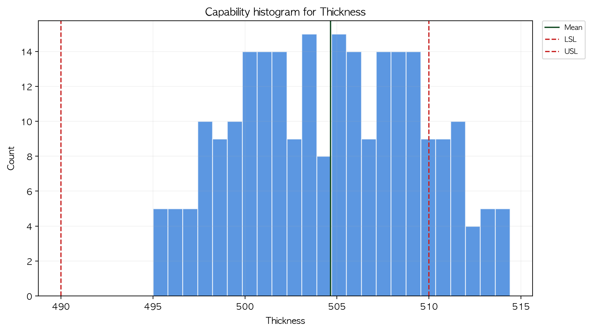
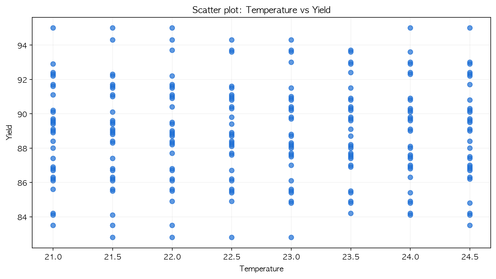

# 공통 L5–L8 스킬 엔지니어링 파이프라인 구성 및 적용 결과 보고서

> **핵심 요약:** L1–L4 표준 계약 검증 이후 동작하는 공통 **L5–L8 파이프라인**을 적용해 기존 원문 8종(`21,667B`)을 **100% 무손실 보존**하면서 진입 지침을 **`12,467B (-42.5%)`** 로 경량화하고 상시 규칙(`2,353B`, `11/11`) 및 릴리스 게이트(`20/20`)를 구축했습니다. 캐시·기계어 힌트를 제거한 순수 자연어 6단계 비교에서도 **입력 토큰 `-48.0%` (`219,620 → 114,242`)** 절감과 동시에 **정규성·사전 가정 검증 `3회 → 8회 (100%)`**, **`"확인 안 함"` 고지 `100%`** 를 달성했습니다.

---

## 01 / 공통 L5–L8 파이프라인 구성 및 제어 흐름

1. **Admission Gate (L1–L4 검증 관문):** 메타 스키마, `status == "verified"`, 어댑터 및 L4 오라클 등록 여부를 코드로 검증해 미흡한 계약은 L5 진입 전 차단합니다.
2. **L5 · 업무 지식 구축 (`knowledge.json`, `policy.json`, `intent_catalog.json`):** 도메인 규칙과 의도 라우팅을 정규화하고 `rule_id`, `owner`, `source_ref`를 강제하며 미확인 규칙은 `unknown`으로 격리합니다.
3. **L6 · 워크플로 설계 (`workflow.json`, `dependency_graph.json`):** 승인된 기능 레지스트리(48개) 기반 DAG를 구성하고 순환, 타입 불일치, 규칙 충돌(`conflict_group`)을 정적 검사로 차단합니다.
4. **L7 · 스킬 컴파일 (`SKILL.md`, 상시 규칙, `examples/`, `skill_manifest.json`):** 기존 문서는 바이트 동일로 보존하고 문서별 `topics:` 색인을 부여하며, 핵심 규칙은 상시 적용 규칙으로 승격 분리합니다.
5. **L8 · 격리 검증 · 폐루프 개선 · 해시 잠금 배포:** 임시 격리 환경 실호출 + 결정론적 L4 오라클 + 컨텍스트 분리 독립 Judge로 메인(16)과 잠금된 Holdout(4)을 판정합니다. 실패 시 해시 중복 제거 큐레이션 후 지식/워크플로/스킬 계층만 최소 수정하며(테스트·오라클 완화 차단), 전 게이트 통과 시 SHA-256 매니페스트로 배포하고 즉시 롤백을 지원합니다.

---

## 02 / 파이프라인 적용 전후 결과 비교 (캐시 초기화 재측정 기준)

| 비교 항목 | 적용 전 (`v0.1.1`) | 적용 후 (`v0.1.2`) | 핵심 변화 및 근거 |
|---|---|---|---|
| **진입 지침 (`SKILL.md`)** | `21,667B` *(미검증 메모 포함)* | **`12,467B (-42.5%)`** + `topics:` 색인 | 원문 8종(`100%`) 무손실 보존 |
| **상시 규칙 승격 · 활성도** | `0B` · 상단 반영 `8/11 (72.7%)` | **`2,353B`** · **`11/11 (100%)`** | 하단·타 환경 규칙 상시 승격 |
| **패키징 · L8 릴리스 게이트** | `3/8` · 게이트 없음 *(단위 15/15)* | **`8/8` · Gate `20/20`** *(실호출 84.63ms)* | 허위 완료 `0건` · 잠금 Holdout `4/4` |
| **자연어 입력 토큰 / 총 토큰** | `219,620` / `240,791` | **`114,242 (-48.0%)`** / **`136,849 (-43.2%)`** | 불필요 스키마 열람 `21 → 16회 (-23.8%)` |
| **실행 시간 / 분석 MCP 호출** | `251.79초` / `34회` | **`255.06초` / `40회`** *(오류 0건)* | 동일 시간 내 **+6회 검증 분석** 완수 |
| **정규성 검정 / 기술통계 요약** | `3회` *(상관·Trial 정규성 누락)* / `2회` | **`8회 (100%)`** / **`7회 (+250%)`** | 비정규성 포착 후 비모수 Spearman 병행 |
| **미확인 가정 고지 규칙** | `0건` *(고지 누락)* | **`2/2건 ("확인 안 함" 명시)`** | 등분산 미수행 투명 명시 |

---

## 03 / 자연어 실기 테스트 (프롬프트 · 실제 그래프 · 수치 표 · 해석 비교)

### 실무 자연어 6단계 프롬프트 원문

```text
공정 데이터 분석 도구를 사용해 아래 품질 분석 요청을 순서대로 처리해 주세요. 별도 웹 화면(브라우저)을 새로 띄우지 말고, 모든 핵심 수치 표·생성된 그래프 이미지·쉬운 한국어 해석을 이 대화 응답 안에 직접 포함해 주세요.

1) 내장된 샘플 목록에서 공정 품질 관련 데이터를 찾아 불러오고, 컬럼 구성과 데이터 요약부터 확인해 주세요.
2) 수율(Yield)이 82.8 이상 95.0 이하인 정상 범위 전체를 대상으로, L1 라인과 L2 라인의 수율 평균에 차이가 있는지 비교·검정해 주세요.
3) 두께(Thickness)에 대해 규격 하한 490, 상한 510 기준으로 공정능력을 평가하고, 필요한 사전 확인 절차를 거친 뒤 공정능력 분포 그래프(격자선과 제목 포함)를 대화창에 바로 보여 주세요.
4) 온도(Temperature)와 수율(Yield)이 함께 변하는지 상관관계를 확인하고, 산점도 그래프도 대화창에 바로 띄워 의미를 해석해 주세요.
5) 함께 제공되는 측정시스템(Gage R&R) 샘플 데이터도 새로 불러와 컬럼 성격을 점검한 뒤, Part·Operator 기준 반복성·재현성을 분석하고 회차(Trial)별 두께 차이도 함께 비교해 주세요(Trial은 연속 숫자가 아니라 1·2·3회차 구분 그룹으로 다뤄 주세요).
6) 첫 번째 공정 데이터의 전체 분석 결과를 자동 그래프 포함 HTML 보고서로 만들고 프로젝트로 저장한 뒤, 저장 목록과 재불러오기(복원)까지 정상 동작하는지 검증해 주세요.

최종 답변에서는 각 단계의 실제 분석 수치(필터 후 행 수, 검정 통계량과 p-value, 공정능력 지수 등), 생성된 그래프 이미지 및 파일 경로, 복원된 데이터 확인 결과, 그리고 실무자가 바로 이해할 수 있는 한국어 종합 해석을 빠짐없이 정리해 주세요.
```

### 실제 생성 그래프 (대화 응답 본문 직접 출력)




### 핵심 분석 수치 요약 (적용 후 실측 기준)

- **L1 vs L2 수율 비교 (`82.8 ≤ Yield ≤ 95.0`):** `last: true` 적용 240행 전체 유지(L1 80행 vs L2 80행), 평균 88.8475 vs 88.8738(차이 -0.02625, `t = -0.0587`, **`p = 0.9533`**), L1/L2 정규성 만족(`p = 0.7095, 0.7552`), 등분산 별도 확인 안 함 명시.
- **두께 공정능력 (`LSL=490, USL=510`):** 평균 `504.6438`, `Cp = 1.0107`, **`Cpk = 0.5414`**, `Pp = 0.6788`, **`Ppk = 0.3636`**, 비정규성(`W = 0.9802, p = 0.0020`) 및 MR 관리이탈 **10건**(17행 주기) 탐지.
- **온도–수율 상관분석:** 온도 비정규성(`p = 1.22e-9`) 확인 후 Pearson **`r = 0.0101` (`p = 0.8767`)** 및 Spearman **`ρ = 0.0060` (`p = 0.9262`)** 동시 확인.
- **Gage R&R · 회차(Trial) 비교:** `Trial`을 `nominal`로 전환 후 Trial 1·2·3 각 30행 정규성(`p = 0.3070, 0.2832, 0.3486`) 전원 확인, ANOVA **`F = 0.0065, p = 0.9935`**(회차 드리프트 없음). Total Gage R&R **%StudyVar = `24.96%`**, 분산 기여율 `6.23%`, **`ndc = 5`**, 작업자(`Operator`) 차이 **`p = 4.13e-6`** 확인.
- **HTML 보고서 · 프로젝트 복원:** **16섹션**(`1,218,154B`, 자동 동반 그림 10건) 보고서 생성 및 `ds0003` 재불러오기(`16건` 이력·PNG 2건) 검증 완료.

### 적용 후(`v0.1.2`) 한국어 실무 종합 해석

1. **수율은 라인 간 차이가 없고 온도와도 무관:** L1·L2 평균 수율은 ~88.9%로 동일하며(`p = 0.9533`), 현재 온도(21.0~24.5) 범위는 수율에 유의한 영향을 주지 않습니다(`p > 0.87`). 수율 개선을 위해서는 `Process`, `Recipe`, `Tool`, `Thickness` 등 다른 인자 중심의 원인 분석이 효과적입니다.
2. **가장 시급한 품질 과제 — 두께 중심 이동 및 산포 저감:** `Thickness` 평균(504.64)이 상한(510) 쪽으로 치우쳐 있고 17행 주기의 급격한 변동(MR 관리이탈 10건)이 동반되어 `Cpk = 0.5414`, `Ppk = 0.3636`으로 규격 이탈이 발생하고 있습니다. 공정 중심을 `500.0` 수준으로 하향 타겟팅하고 주기적 단차의 원인 설비/조건(`Tool` 등)을 점검해야 합니다.
3. **측정시스템(Gage R&R) 개선 포인트는 ‘작업자 표준화’:** 반복 회차(Trial) 간 차이는 전혀 없으나(`p = 0.9935`), 총 Gage R&R(`%StudyVar 24.96%`) 중 작업자 간 재현성 변동(`p = 4.13e-6`)이 주요 원인이므로 작업자(`Kim/Lee/Park`) 간 측정 프로토콜 및 시편 거치·영점 조정 표준화가 필요합니다.

---

*참조 실증 대상: MCP 기반 통계·공정 품질 분석 워크벤치 스킬 패키지 실증 사례 (대상 버전 `v0.1.1` → 파이프라인 적용 `v0.1.2`).*
